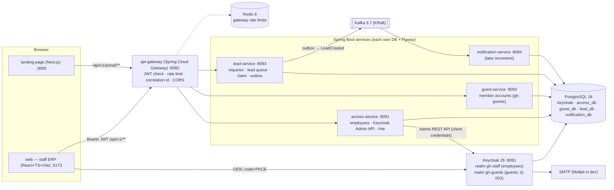

# Architecture Overview — Golden Hills Resort ERP (Phase 1)

- Status: **Proposed. Waiting for Ashish's review** (Milestone 1, 2026-11-15).
- Baseline: Phase 1 Blueprint (extract), which Ashish adopted on 2026-11-15. Decisions: [ADR-001](adr/ADR-001-microservices-and-stack.md), [ADR-002](adr/ADR-002-keycloak-employee-identity.md), [ADR-003](adr/ADR-003-fresh-start-archive.md).
- Audience: developers joining the project. Read [DAY-ONE](../00-onboarding/DAY-ONE.md) first.

## 1. What Phase 1 delivers

A working path from the public website to the sales team (Blueprint §8, §20):

1. A visitor browses the **landing page** (`landing-page/`, Next.js, unchanged), registers or logs in as a guest, and submits an inquiry.
2. The inquiry becomes a **lead**.
3. **Employees** log in to the staff ERP with Keycloak, and an **Admin** onboards and deactivates employees.
4. A **Sales Executive** sees the lead queue and claims a lead. Only one executive can win a claim.

Not in Phase 1 (Blueprint §8, confirmed by Ashish on 2026-11-15): confirmed bookings, room allocation, payment collection, OTA, folio, POS, housekeeping, membership/RFID and HR. The follow-ups, status machine, SLA escalation, notifications, reassignment, conversion requests and CMS are **Phase 1 features scheduled for a later increment** (see phase1_plan.md §6).

## 2. System diagram



**The gateway listens on `:8082`.** That is the URL the unchanged landing page already calls (`portal-client.ts` falls back to `http://localhost:8082/api/v1/portal`), so the public site works with no code or config change.

## 3. Services (Blueprint §4: build a service only when it has a real use case)

| Service | Owns | Phase 1 increment | Port |
|---|---|---|---|
| `api-gateway` | Routing, JWT validation, rate limits (Redis), request-size limits, correlation IDs, CORS. **No business logic, no DB** | 1 | 8082 |
| `access-service` | Employee profiles, Keycloak account provisioning and sync, `/me`, account audit. Blueprint "Access Control" service. Long-term ownership of employee records versus the future HR & Workforce service: Q-028 | 1 | 8091 |
| `guest-service` | Guest and member accounts in Keycloak `gh-guests`, welcome email via the extension `gh-member-activation`, guest profile (Blueprint §6 Guest & CRM) | Gold Membership increment (D-119…D-122; supersedes D-114). See [MEMBER-LOGIN.md](identity/MEMBER-LOGIN.md) | 8092 |
| `lead-service` | Inquiries/leads, public reference, activity history, atomic claim, transactional outbox | 2 | 8093 |
| `notification-service` | Email adapter, delivery attempts, retries, dead-letter queue | Later increment (with SLA) | 8094 |
| CMS | Public content | Not scaffolded. The landing page is static today; Blueprint Q-015 (CMS in Phase 1?) is open | — |

Each service is its own Maven project (its own `pom.xml`, Dockerfile, tests and CI job; Blueprint ADR-015). No service touches another service's database (Blueprint §2).

## 4. Data ownership (Blueprint §6)

| Database | Owner | DB user | Contents |
|---|---|---|---|
| `keycloak` | Keycloak | `keycloak` | Credentials, sessions, identity: only Keycloak touches it |
| `access_db` | access-service | `access_svc` | `employee`, `audit_event`, `idempotency_key` ([AUTHENTICATION §9](identity/AUTHENTICATION.md)) |
| `guest_db` | guest-service | `guest_svc` | `guest_account` (Keycloak user id, email, names, mobile, source, welcome sent) + append-only `audit_event`. **No passwords, no membership data** (D-120); consent later |
| `lead_db` | lead-service | `lead_svc` | `lead`, `lead_activity`, `outbox_event`, `idempotency_key` |
| `notification_db` | notification-service | `notification_svc` | Delivery attempts (later) |

One PostgreSQL 18 cluster with a separate database and a separate least-privilege user per service (Blueprint §6 allows this for the first environment). Flyway migrations per service. No hard deletes: use status changes.

## 5. Communication

- **Synchronous:** REST/JSON via the gateway. Service-to-service calls (rare in Phase 1) use timeouts, bounded retries and propagate `X-Correlation-Id`.
- **Asynchronous:** Kafka. Phase 1 events: `LeadCreated` (increment 2), with `LeadClaimed` and the others added along with their features. Every event has the Blueprint §5 envelope (`eventId, eventType, eventVersion, occurredAt, producer, correlationId, aggregateId`). Events are written to the `outbox_event` table **in the same transaction** as the business change, then published by a relay. Consumers keep processed `eventId`s, so a repeated event is handled once.
- **A lead must never be lost** if Kafka is down. The DB commit is what counts; the outbox catches up later (Blueprint §9 Journey E).

## 6. Security architecture

Full detail: [identity/AUTHENTICATION.md](identity/AUTHENTICATION.md).
- Staff: Keycloak realm `gh-staff`, OIDC Authorization Code + PKCE, tokens kept in memory, 5-minute access tokens, refresh-token rotation.
- Every service is an OAuth2 resource server: it checks the JWT signature (JWKS), `iss`, `exp`, and `aud=erp-api`. Permissions come from the `erp-api` client roles. Every request goes through the checks authenticated → permission → record scope → transition → audit.
- Guests: a separate realm, `gh-guests`. How the unchanged landing-page login maps onto it is Q-003.
- Secrets come only from environment variables or a secrets manager; gitleaks runs in CI.
- HTTPS everywhere outside local dev.

## 7. Repository layout

```text
ERP_Resort/
├── landing-page/                      public website (Next.js) — UNCHANGED in Phase 1
├── ERP_DEV/
│   ├── services/
│   │   ├── api-gateway/               README now; code in increment 1
│   │   ├── access-service/            README now; code in increment 1
│   │   ├── guest-service/             member accounts + welcome email (Gold Membership)
│   │   └── lead-service/              README now; code in increment 2
│   ├── web/                           staff ERP (React) — README now; code in increment 1
│   ├── infra/                         README now; docker-compose + Keycloak realm in increment 1
│   └── docs/
│       ├── README.md                  documentation index
│       ├── 00-onboarding/             DAY-ONE, GLOSSARY
│       ├── 01-requirements/           REQUIREMENTS, TRACEABILITY, CHANGE_REQUESTS, source-extracts/
│       ├── 02-architecture/           this file, api.md, identity/, adr/
│       ├── 03-phases/phase-1/         phase1_plan.md
│       └── logs/                      STATE, DEVLOG, DECISIONS, OPEN_QUESTIONS, RISKS, RESOURCES_LOG
├── .github/workflows/ci.yml           secret scan · landing-page check · per-service builds
├── AGENTS.md, .opencode/              agent operating rules (erp-prp)
└── archive (git only)                 branch archive/hotel-draft, tag archive-hotel-draft-2026-11-15
```

`notification-service/` isn't created until its increment starts (Blueprint §4: no empty placeholder services).

## 8. Local environment (increment 1, slice S1 — built)

```bash
docker compose --env-file ERP_DEV/.env -f ERP_DEV/infra/docker-compose.yml up -d --wait
```

This starts PostgreSQL 18 (host port **5433**, because a system PostgreSQL often owns 5432), Keycloak 26.8.2 (:8081, realm `gh-staff` imported), Redis 8 (:6379, password required) and Mailpit (SMTP :1025, UI http://localhost:8025). All ports bind to 127.0.0.1. Kafka joins in increment 2. Exact steps: [DAY-ONE §5](../00-onboarding/DAY-ONE.md).

## 9. Observability (Blueprint ADR-014, increment 1 baseline)

- JSON structured logs with `correlationId`, `actorId` and `service`. Never log tokens, passwords, action links or full guest messages.
- Spring Boot Actuator `health/readiness/liveness`, plus Micrometer metrics. Prometheus, Grafana and OpenTelemetry tracing are added when staging exists (ops increment; listed in phase1_plan).

**Member tokens at the gateway (D-126, 2026-11-16):** `/api/v1/portal/**` is passed through without reading the bearer token; guest-service and access-service validate gh-guests tokens themselves ([MEMBER-LOGIN.md](identity/MEMBER-LOGIN.md) §5). Staff paths keep the gateway's gh-staff token check.
