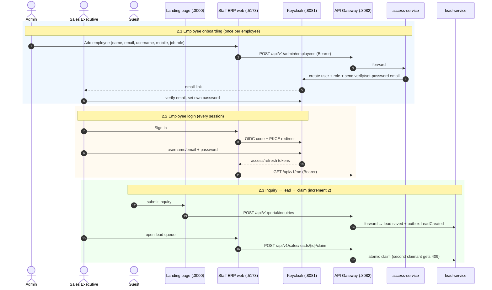

# Phase 1 Master Plan — Guest Acquisition, Identity & Sales Lead Operations

**Document version:** 2.0.0 (draft for review) · **Owner:** Ashish · **Last updated:** 2026-11-15  
**Baseline:** Phase 1 Blueprint (resource folder, 12 Nov 2026), adopted by Ashish on 2026-11-15 ([extract](../../01-requirements/source-extracts/phase1-blueprint-extract.md))  
**Roles in Phase 1:** `ADMIN`, `MANAGER`, `SALES_EXECUTIVE` (staff) · Guest (public)

---

## 0. Change log

| Version | Date | Change |
|---|---|---|
| 1.0.0 | 2026-11-14 | Ashish's first draft: two-role sales CRM (Sales Executive, Sales Admin) with custom email-OTP login, an offline UPI-QR booking form and a payment-screenshot audit |
| 2.0.0 | 2026-11-15 | Reworked after the audit and Ashish's decisions on 2026-11-15: **Keycloak** for all employee identity (ADR-002); follow the **Blueprint** scope, so no booking or payment in Phase 1; **Blueprint microservices** (ADR-001); fresh start with the old ERP archived (ADR-003); new features added in later increments. The removed v1.0 items are listed in §7 so nothing is silently dropped |

## 1. Summary

### 1.1 Why the plan changed
The earlier hotel-operations build (room board, housekeeping, folios, ops console) was premature for current needs. It is archived on branch `archive/hotel-draft` (tag `archive-hotel-draft-2026-11-15`), and the ERP restarts here. The public landing page stays exactly as it is.

### 1.2 Phase 1 goal (Blueprint §8, §20)
- A **guest** opens the Golden Hills website → registers or logs in → submits an inquiry → gets a reference → views the inquiry's status.
- An **employee** is onboarded by an Admin → verifies their email and sets their own password in Keycloak → logs in to the ERP.
- A **Sales Executive** sees authorized leads → claims a lead. Only one executive can win a claim.
- An **Admin** can activate and deactivate employees, and the change takes effect in Keycloak.

### 1.3 Out of Phase 1 (Blueprint §7, §8)
Confirmed bookings, room allocation, payment collection (online or offline), OTA, folio, check-in/out, POS, housekeeping, membership/RFID and HR. "An inquiry is not a confirmed reservation."

---

## 2. End-to-end flow

---

## 3. Employee Registration & Onboarding workflow (admin-driven)

Full specification: [AUTHENTICATION.md §4](../../02-architecture/identity/AUTHENTICATION.md).

1. **Admin creates the employee.** The ERP form captures first name, last name, email, username, mobile number, job role and WhatsApp notification preference. The profile is stored in **`access_db` (PostgreSQL)**. Further fields ("other required information", such as staff code and joining date) are open as Q-017.
2. **Keycloak creates the account.** `access-service` calls the **Keycloak Admin API**, creates the user, stores the **Keycloak user ID** on the employee record (and the employee ID on the Keycloak user), and assigns the realm role.
3. **The employee receives a verification email.** Keycloak's built-in `execute-actions-email` (`VERIFY_EMAIL` + `UPDATE_PASSWORD`) goes out over the realm's **SMTP** settings ([KEYCLOAK-SETUP §8](../../02-architecture/identity/KEYCLOAK-SETUP.md)).
4. **The employee verifies their email and sets a password** on Keycloak's own pages. No custom OTP or password page exists in the ERP.
5. **The account becomes ready.** Once verified and the password is set, the employee can log in. The Admin sees the status (`INVITED` → `ACTIVE`) in the Employees list.

Failure handling: Keycloak down, duplicate email, failed email or an expired link each leave a visible status with a Retry or Resend action ([AUTHENTICATION §10](../../02-architecture/identity/AUTHENTICATION.md)).

## 4. Employee Login & Authentication workflow

Full specification: [AUTHENTICATION.md §5–6](../../02-architecture/identity/AUTHENTICATION.md).

1. **The employee opens the ERP sign-in page** and presses "Sign in", which redirects to Keycloak's hosted login.
2. **Keycloak authenticates them** (OIDC Authorization Code + PKCE). Wrong password, a disabled account or a lockout are refused, with Keycloak's own messages.
3. **Keycloak issues tokens:** a 5-minute JWT access token, a rotating refresh token and an ID token. React keeps them **in memory** and refreshes them before they expire.
4. **Spring Boot checks every request,** first at the gateway and then in each service: signature from Keycloak's JWKS, issuer, expiry, and audience `erp-api`. Bad or missing token → **401**; missing permission → **403**.
5. **Role-based access control:** `ADMIN`, `MANAGER` and `SALES_EXECUTIVE` carry Blueprint §11 permissions. The backend checks permission, then record scope, then transition, and audits sensitive operations.
6. **Dashboard:** `GET /api/v1/me` returns the profile and the permitted modules, and the menu shows only those.

## 5. Logout & account management

- **Logout** ends the Keycloak SSO session (end-session endpoint) and drops the in-memory tokens.
- Expired sessions (30 min idle / 10 h max, Q-019) and invalid tokens send the user back to sign-in.
- **Deactivate:** Keycloak `enabled=false`, then the sessions are revoked, then the ERP status becomes `DISABLED`, with an audit entry and a reason. Keycloak is the source of truth, and a reconciliation job keeps the ERP in step. An access token already issued can work for at most 5 more minutes (R-004).
- **Reactivate / resend invite / change role / change email:** [AUTHENTICATION §7](../../02-architecture/identity/AUTHENTICATION.md).
- Guards: an admin can't deactivate themself, and the last Admin can't be removed.

**Who does what:** Keycloak handles authentication, passwords, verification, reset, tokens, sessions and account status. PostgreSQL holds employee profiles and business data with the Keycloak user ID. Spring Boot handles the Admin API, sync, JWT validation, RBAC and business logic. React handles the sign-in redirect, the dashboard, session handling and role-based visibility.

---

## 6. Delivery increments

Each increment follows the project loop: plan → tests first → thin vertical slices → verify → docs → ask before commit.

### Increment 1 — Platform foundation & employee identity (next)
1. `infra/docker-compose.yml`: PostgreSQL 16 (a database and a user per service), Keycloak 24 with the `gh-staff` realm import, Kafka 3.7, Redis 7, Mailpit.
2. `api-gateway`: routes, JWT validation, Redis rate limits, correlation IDs, CORS for `:3000` and `:5173`.
3. `access-service`: employee CRUD, Keycloak provisioning, status sync job, activate/deactivate, resend invite, `/me`, audit, bootstrap of the first Admin.
4. `web`: Sign-in (redirect), session handling, dashboard shell, Employees admin screens, Sign-out.
5. Tests from [AUTHENTICATION §12](../../02-architecture/identity/AUTHENTICATION.md); CI builds each service.

**Exit:** an Admin onboards a Sales Executive end to end (the invite arrives in Mailpit); the executive logs in and sees their dashboard; deactivation blocks the next login and refresh; 401/403 tests pass; DAY-ONE is verified from a clean clone.

### Increment 2 — Guest inquiry → lead queue → claim
Guest login decided (Q-003 → D-114): pass-through to Keycloak `gh-guests`, landing page unchanged.
1. `guest-service` behind the frozen `/api/v1/portal/auth/**` contract.
2. `lead-service`: inquiry intake (`/api/v1/portal/inquiries`, frozen contract), lead + activity history, `LeadCreated` via the outbox to Kafka, the Sales queue and "my leads", and an **atomic claim**.
3. `web`: lead queue, lead detail, Claim button.
4. The unchanged landing page is checked end to end against the gateway on `:8082`.

### Later increments (Blueprint Phase 1 scope, deferred by Ashish on 2026-11-15: "we will add new features later")
- Notes/activity timeline and follow-ups (Blueprint §10.5).
- The lead status machine with history (Blueprint §10.3).
- The 5-minute claim SLA with escalation, plus `notification-service` (Blueprint §10.6, §12.4).
- Assign/reassign with a reason (Blueprint §10.4/§10.7).
- Conversion request; it does not confirm a booking (Blueprint §7).
- CMS (only if Q-015 says it is in Phase 1); Prometheus, Grafana and OpenTelemetry; staging deployment.

## 7. Items removed from v1.0 (kept here so nothing is silently dropped)

| v1.0 item | Status in v2.0 | Reason / where it goes |
|---|---|---|
| Custom email-OTP + BCrypt + self-issued JWT for staff | **Replaced** by Keycloak (§3–5) | ADR-002; Blueprint §18 |
| `Sales Admin` role with its own provisioning | **Replaced** by `ADMIN` (employee management) and `MANAGER` (sales oversight) | SOW §22 Super Admin / Resort Manager; Blueprint §10.7 |
| Booking form (room number, adults/children, tariff, advance, meal plan, special requests) | **Deferred** to the Reservation module (SOW ERP-02) | Blueprint §7/§8: no confirmed booking or room allocation in Phase 1 |
| Offline UPI QR stand + payment-screenshot upload, revenue KPIs | **Deferred** to Billing & Payments (SOW ERP-07, payment gateway) | Blueprint §8: no payment collection; Sales Executive has no access to payment records (§10.1) |
| Guest ID type/number at booking | **Deferred**, together with booking / check-in | Collecting ID data needs a privacy and retention decision (DPDP, Q-022) |
| Admin "observatory" booking audit with screenshot lightbox | **Deferred** with the booking items above | — |
| Archive by "cleaning `main`" | **Done** as a branch + tag + reviewed merge | ADR-003 |

## 8. Git workflow from here
- Increment work happens on `feature/phase1-<increment>-<slug>`, branched from `feature/phase1-fresh-start`, until that branch is merged into `main`. After that, it branches from `main`.
- Every commit, merge and push needs Ashish's explicit approval. No force-push. Conventional Commits.

## 9. Verification & definition of done (Phase 1)
- Blueprint §15 acceptance criteria for the delivered increments, with test evidence.
- Automated: `mvn -B verify` per service (unit + integration with real PostgreSQL/Keycloak/Kafka via Testcontainers, Q-023); `npm run test`, `tsc -b`, `oxlint` and `vite build` for `web`; landing-page `typecheck` + `build` in CI.
- Security tests: guest token on staff API → 401; executive on admin API → 403; out-of-scope lead → 404; two parallel claims → exactly one success.
- Docs updated in the same change; DEVLOG/STATE updated; no secrets (gitleaks).

## 10. Open questions blocking or shaping this plan
Q-003 guest identity; Q-017 extra employee fields; Q-019 session lengths; Q-020 version upgrade; Q-021 MFA for admins; Q-023 new dev/test dependencies; Q-024 SMTP provider and sender domain; Q-027 CR-001 sales role approval; Q-029 who may onboard employees (Admin only, or GM/HR too). Full list: [OPEN_QUESTIONS.md](../../logs/OPEN_QUESTIONS.md).
